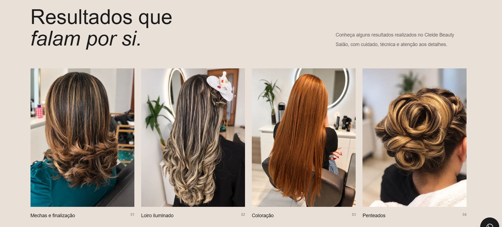
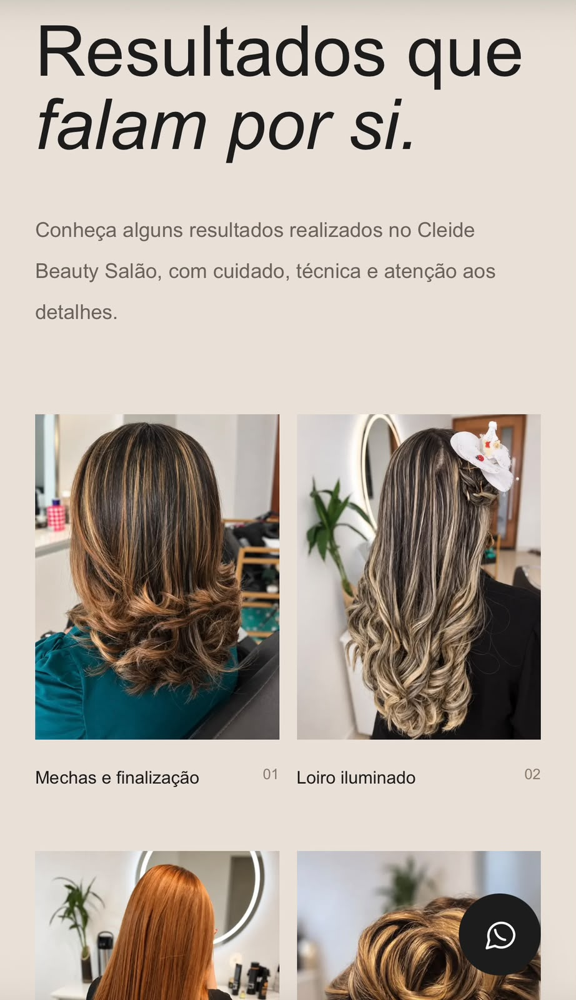

# Cleide Beauty Salão ✨

### Modern Beauty Salon Website

A modern, responsive website developed for a beauty salon, focused on user experience, online visibility, and accessible service information.

🌐 **Live Website:** https://cleide-beauty-salao.vercel.app/

## 🚀 Technologies

- Next.js
- React
- TypeScript
- Tailwind CSS
- Git & GitHub
- Vercel

## ✨ Features

- Responsive layout for desktop and mobile
- Modern and elegant user interface
- Beauty services showcase
- WhatsApp contact and booking integration
- Search engine optimization (SEO)
- Production deployment on Vercel

## 💻 Getting Started

Clone the repository:

```bash
git clone https://github.com/carolina-dev20/cleide-beauty-salao.git
cd cleide-beauty-salao
npm install
npm run dev
```

Open http://localhost:3000 in your browser.


## 📸 Screenshots

### 💻 Desktop Version



### 📱 Mobile Version


  

## 👩‍💻 Developer

Developed by [Carolina](https://github.com/carolina-dev20).

This project demonstrates practical experience in modern frontend development, responsive design, deployment, and SEO.
